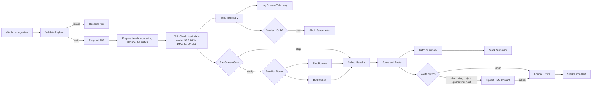

<div align="center">

# 📬 Outbound Cold Email Deliverability Engine

**Verify leads. Audit sending infrastructure. Route by risk. Protect your sender reputation before the first email leaves.**


</div>

---

## Executive Overview

Cold outbound programs rarely fail because of copy. They fail because of **bounces, spam-trap hits, and a burned sending domain**. This engine is a pre-flight control layer that sits between your lead sources and your sequencer:

1. **Ingests** contacts through a secured webhook.
2. **Audits** your sending domains (SPF, DKIM, DMARC, MX, blacklists) and each lead's domain (MX validity).
3. **Verifies** every deliverable candidate through ZeroBounce or BounceBan.
4. **Scores and routes** leads into `clean`, `risky`, `reject`, `quarantine`, `hold`, or `error`.
5. **Tags CRM records** (HubSpot by default) and **alerts Slack**.
6. **Logs telemetry** for every sender-domain audit so reputation trends are traceable.

If a sending domain is blacklisted or scores below your health threshold, the engine places a **campaign HOLD**: no lead is released for dispatch.

## Architecture


> `docs/architecture.png` is a placeholder for your exported diagram. The Mermaid version below renders natively on GitHub.



## Key Features

| Capability | Implementation |
|---|---|
| Real-time verification | Modular HTTP nodes for ZeroBounce and BounceBan, switchable with one env var, with retries and rate-limit batching |
| DNS validation | DNS-over-HTTPS (no extra infrastructure) inside n8n, plus a standalone Node.js CLI/module (`src/dns-validator.js`) |
| Sender health scoring | 0–100 score across SPF (25), DKIM (25), DMARC (25), MX (10), blacklist (15) |
| Blacklist telemetry | Domain and IP DNSBL lookups, with detection of resolver-blocked answers so false "clean" results are flagged as inconclusive |
| Campaign gate | `PASS` / `WARN` / `UNVERIFIED` / `HOLD` computed per batch |
| Lead routing | Deterministic scoring with a documented route table |
| CRM tagging | HubSpot batch upsert keyed on email (`deliverability_*` properties) |
| Resilience | Payload validation, auth header, dedupe, DNS failure tolerance, error output branches, Slack alerts that never break the pipeline |

## Prerequisites

- n8n **1.x or later** (self-hosted; environment access in nodes is required)
- Node.js **18+** (only for the CLI, tests, and workflow validator)
- A **ZeroBounce** or **BounceBan** API key
- A **HubSpot** private app token with `crm.objects.contacts.write` (or adapt the CRM node)
- A **Slack incoming webhook** URL
- Optional: a private recursive DNS resolver for authoritative blacklist lookups (see Known Limitations)

## Installation

```bash
# 1. Clone
git clone https://github.com/<your-org>/outbound-cold-email-deliverability-engine.git
cd outbound-cold-email-deliverability-engine

# 2. Configure
cp .env.example .env
#    edit .env: API keys, WEBHOOK_SHARED_SECRET, SENDING_DOMAINS, etc.

# 3. Validate the repo
npm run validate:workflow
npm test

# 4. Start n8n with the environment loaded
docker run -d --name n8n -p 5678:5678 \
  --env-file .env \
  -v n8n_data:/home/node/.n8n \
  docker.n8n.io/n8nio/n8n
```

5. Open `http://localhost:5678`, then **Workflows → Import from File** and choose `workflows/outbound_deliverability_engine.json`.
6. Create these **HubSpot contact properties** (internal names must match):

| Property | Type |
|---|---|
| `deliverability_route` | Single-line text |
| `deliverability_status` | Single-line text |
| `deliverability_reason` | Single-line text |
| `deliverability_score` | Number |
| `email_verification_provider` | Single-line text |
| `email_verified_at` | Date and time |
| `deliverability_batch_id` | Single-line text |
| `deliverability_campaign_id` | Single-line text |

7. Activate the workflow. The production URL is `http://<host>:5678/webhook/outbound-deliverability`.
8. (Recommended) Create a separate workflow with an **Error Trigger** node that posts to Slack, then set it as this workflow's *Error Workflow* in Settings. This catches crashes outside the built-in error branches.

### Environment variables

All variables are documented in [`.env.example`](.env.example). The most important:

| Variable | Purpose |
|---|---|
| `N8N_BLOCK_ENV_ACCESS_IN_NODE=false` | **Required.** Lets workflow nodes read `$env` values |
| `VERIFICATION_PROVIDER` | `zerobounce` (default) or `bounceban` |
| `SENDING_DOMAINS` / `SENDING_IPS` | Default sender infrastructure to audit (overridable per request) |
| `SENDER_MIN_SCORE` | Health score below which the campaign is held (default 70) |
| `CLEAN_MIN_SCORE` / `RISKY_MIN_SCORE` | Routing thresholds (default 80 / 50) |
| `SANDBOX_MODE` | `true` bypasses reserved-domain and lead-DNS rejection so provider sandbox addresses can be tested |

## Usage

```bash
jq --arg c "q4-fintech-wave1" --argjson d '["mail.yourbrand.com"]' \
   '{campaign_id: $c, sending_domains: $d, leads: .}' \
   test-payloads/sample_leads.json \
| curl -sS -X POST http://localhost:5678/webhook/outbound-deliverability \
    -H "Content-Type: application/json" \
    -H "x-webhook-secret: $WEBHOOK_SHARED_SECRET" \
    -d @-
```

The webhook accepts either a bare array of leads or an object:

```json
{
  "campaign_id": "q4-fintech-wave1",
  "batch_id": "optional-custom-id",
  "sending_domains": ["mail.yourbrand.com"],
  "sending_ips": ["203.0.113.10"],
  "leads": [{ "email": "jane@acme.com", "first_name": "Jane", "company": "Acme" }]
}
```

It responds immediately with `202 {"status":"accepted", ...}` and processes asynchronously. Errors return `400` (bad payload), `401` (bad secret), or `413` (batch too large).

## Scoring and Routing Breakdown

### Verification status → base score

| Provider status | Base score | Notes |
|---|---|---|
| `valid` / `deliverable` | **92** | Safe to send |
| `catch-all` / accept-all | **55** | Server accepts everything; deliverability unprovable |
| `risky` | **50** | Provider-flagged uncertainty |
| `unknown` | **50** | Server did not respond conclusively; retry later |
| `invalid` / `undeliverable` | **0** | Mailbox does not exist |
| `spamtrap`, `abuse`, `toxic`, `possible_trap`, `global_suppression` | **0** | Complaint or trap risk |

**Adjustment:** role-based address (info@, sales@, etc.) → **−15**.

### Score → route

| Route | Condition | CRM effect | Dispatch |
|---|---|---|---|
| `clean` | score ≥ `CLEAN_MIN_SCORE` (80) | `deliverability_route=clean` | ✅ Eligible |
| `risky` | `RISKY_MIN_SCORE` (50) ≤ score < 80 | tagged `risky` (catch-all, unknown, role-based) | ⚠️ Segment: low volume or separate domain |
| `reject` | score < 50, or hard pre-screen failure | tagged `reject` | ⛔ Suppress |
| `quarantine` | spamtrap, abuse, trap-pattern local part | tagged `quarantine` | ⛔ Suppress permanently |
| `hold` | would be clean/risky but sender gate = `HOLD` | tagged `hold` | ⏸ Resubmit after fixing infrastructure |
| `error` | verification API failure | not written to CRM | 🔁 Slack alert, resubmit |

### Pre-screen hard rejections (no verification credit spent)

`missing_email`, `missing_domain`, `invalid_syntax`, `reserved_domain`, `disposable_domain`, `trap_pattern`, `dns_nxdomain`, `dns_no_mx_records`, `dns_null_mx`, `dns_mx_hosts_unresolvable`. Duplicates within a batch (case and whitespace normalized) are dropped.

Leads with no syntactically valid email are classified but cannot be written to the CRM, so they appear only in the Slack summary.

### Worked examples

| Lead | Calculation | Route |
|---|---|---|
| Valid mailbox at a company | 92 | clean |
| Valid role mailbox (`info@`) | 92 − 15 = 77 | risky |
| Catch-all domain mailbox | 55 | risky |
| Catch-all role mailbox | 55 − 15 = 40 | reject |
| Unknown | 50 | risky |

### Sender health gate

| Component | Points |
|---|---|
| SPF present, single record | 15 |
| SPF terminal `-all` or `~all` | 5 |
| SPF ≤ 10 top-level lookups | 5 |
| DKIM active key at a tested selector | 25 |
| DMARC `p=reject` / `quarantine` / `none` | 25 / 22 / 10 (−3 if `pct<100`) |
| Sending-domain MX valid | 10 |
| Blacklist: clear / inconclusive / listed | 15 / 8 / 0 |

Gate result: `HOLD` if any domain or IP is listed, or any score < `SENDER_MIN_SCORE`; `WARN` if issues exist but thresholds pass; `UNVERIFIED` if no sending domains were supplied (set `REQUIRE_SENDER_AUDIT=true` to hold instead).

## Standalone DNS Validator

```bash
node src/dns-validator.js mail.yourbrand.com --selectors google,selector1 --min-score 70
```

Exits non-zero if the domain is blacklisted or scores below the minimum, so it can gate CI or provisioning scripts. It can also be imported:

```js
const { validateDomain } = require('./src/dns-validator');
const report = await validateDomain('mail.yourbrand.com');
```

## Testing

```bash
npm test                    # unit tests for SPF/DMARC/DKIM parsing and scoring helpers
npm run validate:workflow   # JSON integrity, connection graph, Code-node syntax
```

For an end-to-end dry run, set `SANDBOX_MODE=true`, use `test-payloads/sample_leads.json`, and compare each lead's `expected_route`. The `example.com` addresses follow ZeroBounce's published sandbox test addresses; confirm the current list in their documentation. Leads marked provider-dependent can legitimately vary.

## Known Limitations

- **Public resolvers and DNSBLs:** Spamhaus, URIBL, and others refuse or throttle queries from public resolvers. The engine detects these refusal codes and reports `inconclusive` instead of a false `clear`. For authoritative results, point `DNS_DOH_ENDPOINT` at your own recursive resolver.
- **DKIM selectors cannot be enumerated.** The engine tests a configurable list (`DKIM_SELECTORS`). Add the selectors your ESP uses.
- **SPF lookup counting is top-level only.** Nested includes can still push you past the 10-lookup limit.
- **Provider response mappings** (especially BounceBan) should be confirmed against current provider documentation before production use.
- **Heuristic lists** (role and trap local-parts, disposable domains, free-mail domains) are intentionally conservative starting points. Extend them for your market.

## Security Notes

- Never commit `.env`. Rotate any key that has been exposed.
- Set a long random `WEBHOOK_SHARED_SECRET` and place the webhook behind TLS.
- ZeroBounce authenticates via query string, so keys may appear in n8n execution logs. Restrict execution-log access and retention accordingly.

## ⚠️ Disclaimer & Liability Limitation

**Use at your own risk.** The code, workflows, and scripts provided in this repository (`outbound-cold-email-deliverability-engine`) are for educational and architectural demonstration purposes. 

* **No Liability:** The author and **dhRobin Systems** assume **no responsibility or liability** for any direct, indirect, incidental, or consequential damages resulting from the use, misuse, or deployment of these scripts and workflows. 
* **Sender Reputation & Deliverability:** Email infrastructure verification, automated domain auditing, and bulk outreach operations carry inherent risks. Misconfigured filters, bad API calls, or aggressive sending patterns can negatively impact domain health, trigger spam filters, or lead to blacklisting. 
* **User Responsibility:** You are solely responsible for compliance with local and international email regulations (such as CAN-SPAM, GDPR, and CASL), API rate limits, provider terms of service, and ensuring proper testing (`SANDBOX_MODE=true`) before connecting any scripts to production environments or live sending domains.

## Contributing

1. Fork the repository and create a feature branch (`feat/<short-name>`).
2. Keep workflow Code nodes free of double quotes and backslashes so the JSON stays safely hand-editable, or regenerate the JSON from n8n's export.
3. Run `npm run validate:workflow` and `npm test`. CI enforces both.
4. Update the README scoring tables whenever scoring logic changes.
5. Open a pull request describing the change, the test evidence, and any new environment variables.

Please report security issues privately to the maintainers rather than opening a public issue.

## License

Released under the **MIT License**. See [LICENSE](LICENSE).
