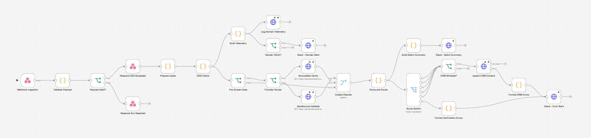

<div align="center">

# 📬 Outbound Cold Email Deliverability Engine

**Verify leads. Audit sending infrastructure. Route by risk. Protect your sender reputation before the first email leaves.**


</div>

---

## Executive Overview

Cold outbound programs rarely fail because of copy. They fail because of **bounces, spam-trap hits, and a burned sending domain**. This engine is a pre-flight control layer that sits between your lead sources and your sequencer:

1. **Ingests** contacts through a secured webhook.
2. **Audits** your sending domains (SPF, DKIM, DMARC, MX, blacklists) and each lead's domain (MX validity).
3. **Verifies** every deliverable candidate through ZeroBounce or BounceBan.
4. **Scores and routes** leads into `clean`, `risky`, `reject`, `quarantine`, `hold`, or `error`.
5. **Tags CRM records** (HubSpot by default) and **alerts Slack**.
6. **Logs telemetry** for every sender-domain audit so reputation trends are traceable.

If a sending domain is blacklisted or scores below your health threshold, the engine places a **campaign HOLD**: no lead is released for dispatch.

## Architecture



> `docs/architecture.png` is the exported diagram of the workflow pipeline. The Mermaid version below renders natively on GitHub.

```mermaid
flowchart LR
    A[Webhook Ingestion] --> B[Validate Payload]
    B -->|invalid| X[Respond 4xx]
    B -->|valid| C[Respond 202]
    C --> D[Prepare Leads<br/>normalize, dedupe, heuristics]
    D --> E[DNS Check<br/>lead MX + sender SPF/DKIM/DMARC/DNSBL]
    E --> T[Build Telemetry] --> TL[Log Domain Telemetry]
    T --> H{Sender HOLD?} -->|yes| SA[Slack Sender Alert]
    E --> F{Pre-Screen Gate}
    F -->|skip| M[Collect Results]
    F -->|verify| P{Provider Router}
    P --> ZB[ZeroBounce] --> M
    P --> BB[BounceBan] --> M
    M --> S[Score and Route]
    S --> SW{Route Switch}
    S --> SUM[Batch Summary] --> SS[Slack Summary]
    SW -->|clean/risky/reject/quarantine/hold| CRM[Upsert CRM Contact]
    SW -->|error| ER[Format Errors] --> SE[Slack Error Alert]
    CRM -->|failure| ER

## Key Features

| Capability | Implementation |
|---|---|
| Real-time verification | Modular HTTP nodes for ZeroBounce and BounceBan, switchable with one env var, with retries and rate-limit batching |
| DNS validation | DNS-over-HTTPS (no extra infrastructure) inside n8n, plus a standalone Node.js CLI/module (`src/dns-validator.js`) |
| Sender health scoring | 0–100 score across SPF (25), DKIM (25), DMARC (25), MX (10), blacklist (15) |
| Blacklist telemetry | Domain and IP DNSBL lookups, with detection of resolver-blocked answers so false "clean" results are flagged as inconclusive |
| Campaign gate | `PASS` / `WARN` / `UNVERIFIED` / `HOLD` computed per batch |
| Lead routing | Deterministic scoring with a documented route table |
| CRM tagging | HubSpot batch upsert keyed on email (`deliverability_*` properties) |
| Resilience | Payload validation, auth header, dedupe, DNS failure tolerance, error output branches, Slack alerts that never break the pipeline |

## Prerequisites

- n8n **1.x or later** (self-hosted; environment access in nodes is required)
- Node.js **18+** (only for the CLI, tests, and workflow validator)
- A **ZeroBounce** or **BounceBan** API key
- A **HubSpot** private app token with `crm.objects.contacts.write` (or adapt the CRM node)
- A **Slack incoming webhook** URL

## Installation

```bash
# 1. Clone
git clone [https://github.com/dhrobinsystems/outbound-cold-email-deliverability-engine.git](https://github.com/dhrobinsystems/outbound-cold-email-deliverability-engine.git)
cd outbound-cold-email-deliverability-engine

# 2. Configure
cp .env.example .env

# 3. Validate the repo
npm run validate:workflow
npm test

## Scoring and Routing Breakdown

| Route | Condition | CRM effect | Dispatch |
|---|---|---|---|
| `clean` | score ≥ 80 | `deliverability_route=clean` | ✅ Eligible |
| `risky` | 50 ≤ score < 80 | tagged `risky` | ⚠️ Segment separately |
| `reject` | score < 50 | tagged `reject` | ⛔ Suppress |
| `quarantine` | spamtrap, abuse | tagged `quarantine` | ⛔ Suppress permanently |
| `hold` | sender gate = `HOLD` | tagged `hold` | ⏸ Resubmit after fix |

## ⚠️ Disclaimer & Liability Limitation

**Use at your own risk.** The code, workflows, and scripts provided in this repository (`outbound-cold-email-deliverability-engine`) are for educational and architectural demonstration purposes. 

* **No Liability:** The author and **dhRobin Systems** assume **no responsibility or liability** for any direct, indirect, incidental, or consequential damages resulting from the use, misuse, or deployment of these scripts and workflows. 
* **Sender Reputation & Deliverability:** Email infrastructure verification, automated domain auditing, and bulk outreach operations carry inherent risks. Misconfigured filters, bad API calls, or aggressive sending patterns can negatively impact domain health, trigger spam filters, or lead to blacklisting. 
* **User Responsibility:** You are solely responsible for compliance with local and international email regulations (such as CAN-SPAM, GDPR, and CASL), API rate limits, provider terms of service, and ensuring proper testing (`SANDBOX_MODE=true`) before connecting any scripts to production environments or live sending domains.

## Contributing

1. Fork the repository and create a feature branch.
2. Run `npm run validate:workflow` and `npm test`.
3. Open a pull request describing the change.

## License

Released under the **MIT License**. See [LICENSE](LICENSE).
